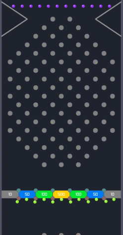

# The Front Door

Come in out of the cold. The parlour closed an hour ago, but the machine in
the corner is still lit, and it is a strange one: two pachinko boards, one
above the other, the bottom one upside down, so that its balls fall *up*.
They meet in the middle, at the gates.

Nobody built this to sell. It was built to see what happens when every ball
gets a mind of its own, each one worked out on its own thread of the
machine's processor, all at once, sixty times a second.

## The rooms

| Room | What is there |
|------|---------------|
| [The floor](057-the-floor.md) | the machine in motion: what happens when balls meet |
| [The drawing table](058-the-drawing-table.md) | where boards are drawn, and the balls that exist only on paper |
| [The parlour wall](059-the-parlour-wall.md) | pachinko itself: where it came from, where to see it, who loves it |
| [The story so far](060-the-story-so-far.md) | five days in March, and an evening in October |

## Out back

The workshop, where the source and all the paperwork live, is not open yet;
when it is, its door will be here. Next door is the
[house this machine lives in](../../../../README.md), with all its other
rooms.
