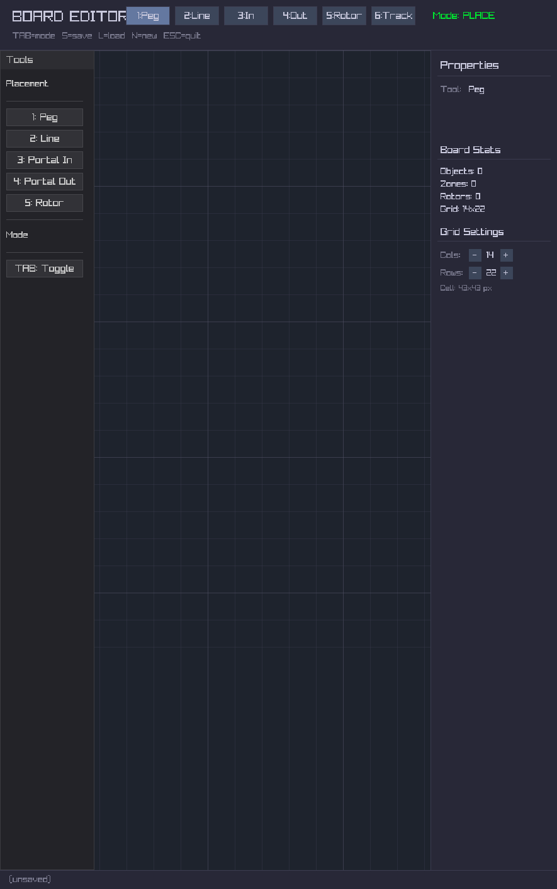

# The Drawing Table

Under the lamp at the back: a grid, a pencil, and a box of pegs. Every board
the machine plays was drawn here, crossing by crossing.

## Colour is physics

On this table a peg's colour is not decoration. It *is* the peg.

| Colour | What it does |
|--------|--------------|
| more red | bouncier |
| more green | grippier, so a rolling ball holds on |
| more blue | pays out points each time a ball touches it |

So you can read a board before a single ball drops: a reddish corner will be
lively, a green ramp will hold a ball, a blue peg is worth aiming for. For
anyone who would rather not mix colours, there is a shelf of ready ones:
stone, ice, rubber, sticky, bouncy, glass and metal.

There are spinning arms too, and tracks that carry pieces of the board along
them, and portals that swallow a ball and drop it somewhere else.

## Balls on paper

Pinned above the table are balls nobody has made yet:

- a **heavy** ball, twice the weight, that shoulders others aside;
- a **bouncy** one that hardly loses a thing on each hit;
- a **sand** ball that drops as ten grains in a little hexagon and scatters;
- a **ghost** that passes through the first three things it meets;
- a **split** ball that halves at its first peg, "and when each smaller ball
  passes through a gate, they reset to their original state, allowing for
  additional growth";
- a **magnet** that pulls its neighbours close and "lowers the restitution of
  nearby balls, proportional to distance, to help with clumping."
