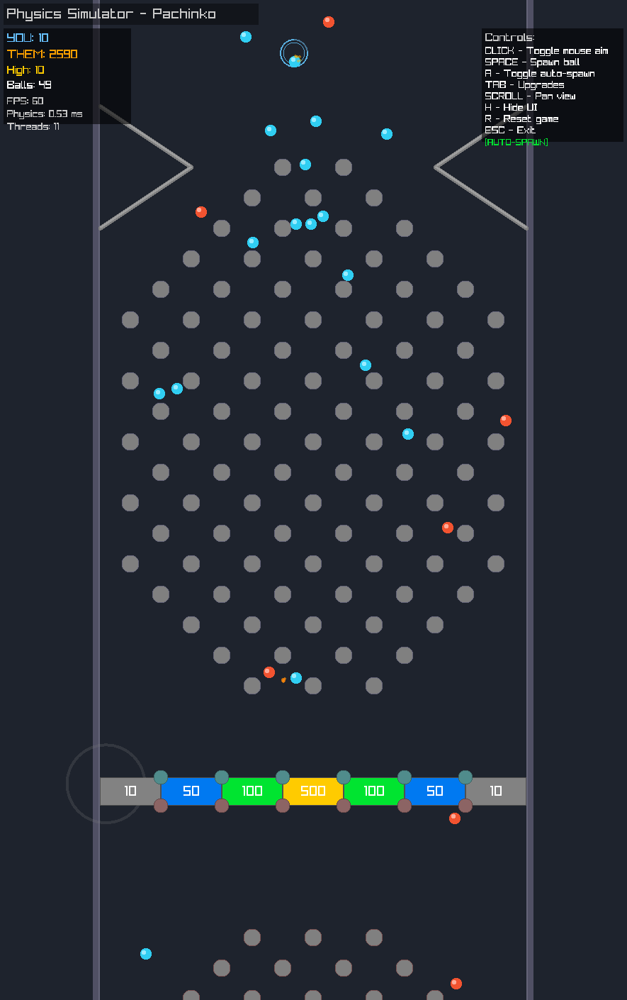

# The Story So Far

It was built in five days in March 2026. On the first day it went from an
empty folder to a playable machine with an opponent, eighty-two small steps
before ten at night, most of the late ones fixing things found by playing:
balls that came back after scoring, balls that could be stacked inside each
other. On the second day it grew a drawing table inside itself, and on the
third the table was carried out into its own room.

On the fourth day it was called finished. Two days later it turned out that
four parts of the machine each had their own idea of where the board was,
and nobody had been given the board. That morning they were made to agree.

Then it rested. In October it learned to stage a single moment and film it,
which is where every moving picture in this lodge comes from.

> uh this didn't get committed somehow. /shrug

The long version is in [the March report](../../../../progress-reports/part-4-one-hundred-and-sixty-seven.md).
